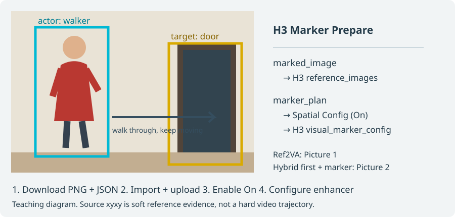

# H3 空间标记提示词增强（实验） / Visual marker authoring

在节点搜索框输入 `T8H3VisualMarkerConfig`、`Visual Marker Config` 或“空间标记增强”。
这是当前提示词增强插件的新配置节点，**默认关闭，仅供 MiniMax H3 使用**。
不用修改或替换 audio 插件的 Prepare / Prompt / Bind；不接入 Seedance、MOSS 或音乐节点。

**直接试用：点击空间配置节点底部「📖 空间标记：示例与接线」。** 弹窗里可下载配套 PNG、
Ref2VA 或 Hybrid JSON。先保存当前工作流，再将JSON拖入ComfyUI、上传PNG，配置增强渠道，将Off切On。
教程展示的是红衣人物走向门口、穿过后继续前进；工作流已填好对应的框和动作。



示例标记：`marker_id=walker`为左侧红衣人物，`marker_id=door`为右侧门口。
`xyxy=[x0,y0,x1,y1]`取原图0..1坐标，表示左上到右下；`relations`用ID说明谁走向哪个目标。
`role_id=A`只是人物声明，不自动等于Subject或说话人编号。使用自己的图时，需要同步修改这些框、描述和动作。

## 怎么接

1. 使用现有 audio 插件的 `H3 Marker · Prepare`，从真实参考图生成标记图和计划。
2. `Prepare.marker_plan` → 本项目 `T8 H3 Visual Marker Config.marker_plan`。
3. 配置输出 → H3 主节点最后的 `visual_marker_config`；把 `Prepare.marked_image` 同时接进 H3 原有的参考图口。
4. H3 选择普通 `Ref2VA`，或带首/尾帧与额外参考的 `Hybrid`；原创意仍写在 H3 的 prompt。
5. 配置选择 On。`picture_selector=0` 自动寻找唯一同图；重复使用同图时填写增强器的实际 Picture 编号。

该编号**不是**下游 Bind 的 `marker_position`。Hybrid 的首、尾帧先占 Picture 编号。
不自动插图、重排、缩放、裁切或猜测编号。错误图、已改像素、未知 schema、坏摘要、缺失关系、歧义会在请求前报错。
只支持一份现有 v1 MarkerPlan，不接受手工报告字符串代替计划。未安装 audio 插件仍能加载本插件；含缺失 Prepare 节点的示例则不能运行。

独立示例：[普通参考](../example_workflows/h3_visual_marker_ref2va.json) / [Hybrid 首帧＋额外标记图](../example_workflows/h3_visual_marker_hybrid.json)。
它们是新文件，未改旧示例；先替换 LoadImage 占位图、按真实图调整框和角色、配置自己的增强渠道。
示例配置同样默认 Off，开启才启用结构化空间规则；示例不是带模型的完整视频生成工作流。

## 再接现有生成工作流

```text
Prepare.marker_plan ──┬── 新 Config ─── H3.visual_marker_config
                      └── 现有 Prompt.marker_plan
Prepare.marked_image ───── H3.reference_images
H3.enhanced_prompt ─────── 现有 Prompt.base_prompt [manual_original]
现有 Prompt.prompt_recipe ── 现有 Bind.prompt_recipe
```

不要用 `generated` 再追加已经写过的图例和动作。Bind 的其他参考图里不重复放 marker，它由 `marker_position` 插入一次。
增强器与 Bind 的首尾帧、其他参考图顺序必须人工保持一致。例如 H3 是 first,last,refA,marker,refB，
Bind 使用相同 first/last、other=[refA,refB]、marker_position=2；对应增强器 selector=4。
`manual_original` 不会替你重写自由文本里的 Picture 编号。不能把下游 binding 报告反接上游造成图循环。

现有 audio 接口的 base_prompt 上限为 64 KiB，展开文本上限 256 KiB。超过时保留完整增强稿，
由用户决定下游处理；本功能不截稿、不缩短时长、不跨项目改上限。确需那边配合时先出交接文档，由用户转交其 Agent。

## 能做什么，不能保证什么

- 用显式 actor ID → target ID 和用户动作完善空间描述；同色、同角色、多角色共享目标、重复关系、手绘缺 xyxy 都允许。
- xyxy 是**源参考图**的归一化区域，不是视频逐帧位置、3D 深度或硬轨迹。颜色不是人物身份；小框不是远处证明。
- 关系数组顺序不是时间轴，重复边不自动执行两次；保留明确先后、同时、次数和终态，不把“经过后继续”改成“到点停住”。
- 质量检查按字段独立保留精确文字，不从重复关系累加台词次数或捏造发声先后；正文明确次数、顺序及语音参考仍由原规则检查。明确禁止的词例不要求加入输出。
- 保持原生六字段、输出语言、精确台词、镜数、时长与已有约束。不新加时长上限或自动拆片，不额外调用独立 LLM。
- 框是参考注释而非剧情物体；提示词要求排除它不等于保证去框成功。人物语义、物理可达、声音身份和视频收益均未被程序认证。
- 首期仅支持普通 Ref2VA / Hybrid 的额外参考图。On＋Relay、关键帧专用任务会明确报未支持；Off 时原有模式不受影响。
- 标记图同时出现在关键帧和额外参考会提示风险，不擅自取消关键帧约束。

## 默认关闭、缓存、隐私

Off/未连接保留同样媒体下的旧消息和调用路径；**不会把已经接进 IMAGE 的框擦掉，也不会跳过独立 IMAGE 分支**。
恢复读取上次完整稿与当时的有限标记元数据，不套用今天的配置；跳过新增配置/plan 依赖，
但既有非 lazy 图片分支和全图静态校验仍按 ComfyUI 原合同执行。恢复不是重启后持久缓存。

实际请求使用选中图片的独立只读 CPU 快照；预算和发送共用它。hash 验证只是输入一致性，不是数字签名或语义认证。
正常图依赖变化会重新求值；整节点 cache 命中时，本代码无法检测图外偷偷修改 tensor 的行为。

云端增强沿原通道发送标记图与必要角色/动作文本，可能增加输入 token 成本。新增日志只保留版本、状态、数量、编号和有限警告码，
不新增存储源 plan/坐标/hash/角色名；原有完整增强稿缓存仍可能包含空间描述。既有疑似 API key 检查覆盖新文本，但不是万能泄密检测。
在“脱敏诊断”中 `enhancer_reference_matched` 只表示增强器附件匹配；`downstream_verified=false`、`semantic_verified=false` 始终保留。
警告码：`hand_drawn_unobserved` 缺几何、`hand_drawn_declared` 人工声明、`overlap` 重叠、`shared_actor_color` 同色、
`shared_role` 同角色、`shared_target` 共享目标、`small_marker` 小框、`marker_also_keyframe` 兼作关键帧。

## 验收范围与来源

工程验收与真实效果分开：协议/负例/关闭基线/修复/恢复、真实生产方只读互通、独立 CPU Comfy 队列、浏览器保存重载不等于模型遵从或成片改善。
效果测试需另外授权真实模型调用：相同 marked 图、创意、模型、时长与采样条件，只切 Off/On，多个 seed 全量记录；
clean 图单独做 C 组。On 获得额外结构化信息，这个对照测的是整个入口，不声称等信息条件下的算法优势。

方法参考 [H3-Visual-Marker-Control](https://github.com/RK-BoilingPoint/H3-Visual-Marker-Control/tree/0f0274f5f07c0e8dda0bb8cd0286256587f4e959)，
数据合同参考 [现有 audio 实现](https://github.com/T8mars/comfyui-minimax-h3-audio-T8/tree/f8f90836c018c0ea509b29831d0aeb0a4c415730)。
非官方空间采样能力；本项目独立编写适配和规则，不复制上游长提示词、样片或修改两个参考项目。

## English quick start

Search **T8H3VisualMarkerConfig / Visual Marker Config**. Connect the existing Prepare plan to this helper,
its config to H3's appended socket, and the same marked image to H3's existing reference-image input.
Default is Off. Enable only for Normal Ref2VA/Hybrid extra references. Zero selects a unique exact match;
otherwise select the actual enhancer Picture ordinal (not Bind.marker_position). No extra planner or duration cap.

For downstream use, connect enhanced_prompt to the existing Prompt.base_prompt in **manual_original** mode,
then its recipe to Bind. Keep media ordering consistent and insert the marker only once. No automatic downstream verification.
Coordinates are source annotations, not hard trajectories; removal and semantic/video benefit are unverified.
Off does not suppress separately connected images. Restore skips the new dependency only, retaining prior media behavior.
Cloud requests include marker text and pixels. Existing context/token limits and downstream text limits still apply.
